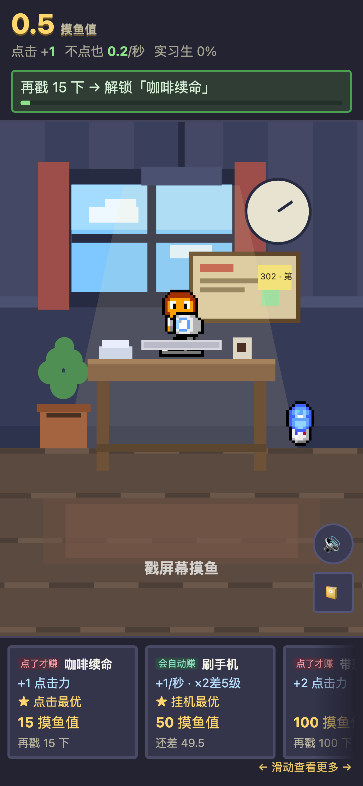

# 摸鱼工位（moyu）

一款摸鱼主题的放置/点击游戏，移动端浏览器竖屏优先，纯前端单机（localStorage 存档），零后端依赖。



> 想先看结论？[交付总结（玩法/修了什么/怎么验证/遗留项）](docs/PROJECT-SUMMARY.md)

## 快速开始

```bash
# 开发（需 Node ≥ 20；本机 PATH 默认 node16，先切 nvm v22）
export PATH="$HOME/.nvm/versions/node/v22.23.2/bin:$PATH"
npm install
npm run dev        # http://127.0.0.1:5173

npm run build      # 类型检查 + 生产构建 → dist/
npm test           # 引擎单测 + 平衡红线探针（159 例）
npm run preview    # 预览生产构建
```

## 玩法

- **戳屏幕摸鱼**：点击场景获得摸鱼值，有飘字/粒子反馈，偶尔蹦梗。
- **工位底薪**：0.2/秒 无条件挂机收入（不买任何升级也在涨）。
- **九档升级**：点击线（咖啡/喝水/人体工学椅）+ 挂机线（刷手机/蹲坑/群聊/会议/深度摸鱼/退休式躺平）。
  - 价格 ×1.15^等级；每满 20 级该项效果 ×2（各档错峰触发，避免全体同频空窗）。
  - 商店卡显示：下一级即时增量、距下次 ×2 还差几级、每万摸鱼值性价比（当前维度最优带 ★）。
- **老板巡逻（三种变体，随机 40%/35%/25%）**：
  - 忍住：8s 内别点，安然度过拿奖励（= max(50, 4×挂机秒收益)）；手滑「偷点」照拿点击收入，但每击罚 0.6 秒挂机收益（单次巡逻封顶 10 秒，0.8s 反应宽限内不罚也不给收入）。
  - 假装工作：8s 内点满 5 次达标（点击不罚）。
  - 摸鱼冲刺：点满 16 次（≈2.3cps），奖励 ×1.5。
  - 连续安然有连胜加成（×(1+0.1N)，封顶 ×1.5，被抓立即清零，入档持久化）。
- **同事丢梗**：限时气泡，戳中 +5×点击力，并收集一条打工人语录。
- **连击链**：点击间隔 <0.5s 累积连击（漏两拍 >1.0s 断），20 连封顶 ×1.24；连击数常驻 HUD。
- **每日日报**（HUD 📔）：每天 3 个小目标（点100下/收1梗/买3级/应付1次巡逻 池选3），奖励 = max(500, **600×挂机秒收益**)（R7 上调 10×），连续天数 streak；streak 每满 7 天永久 +0.05 离线效率。
- **摸鱼图鉴**（📔 面板）：10 条语录 + 9 升级 × 5 档彩蛋 = 55 条收集册。
- **转生「离职再就业」**：本局累计 ≥1 亿解锁，转生点 = floor(3×(本局/1亿)^0.4)（单局封顶 20），每点永久 **+75% 收益**；重置余额与 20% 等级，保留图鉴/日报/段位/历史累计（7 天模拟：不转 620e8 < 见转 1184e8 < 攒够再转 3383e8）。
- **段位**：按累计摸鱼值 **14 档**（实习生 → 摸鱼宇宙尽头·终，2.5e9→3.2e11 续档，D4~D22 各一次晋升），HUD 常驻进度。
- **离线收益**：日常 **12 小时封顶**、≥7 天 24h、≥30 天 48h；建档首日全额；次日起基础 70%，**每次回访 +10%（当日最多 3 次，可挣回 100%）**；≥7 天回归首次结算 100%；切后台/杀页面都按真实时钟补结算。
- **图鉴收集**：点击线彩蛋按**累计点击数**（100/500/3000/8000/20000）解锁，挂机线按等级；**每集齐 5 格永久挂机 +2%（55 格 +20%）**。

## 架构

```text
src/engine/    纯函数游戏逻辑（无 DOM，可完全单测）
  state.ts       GameState + gain() 统一进账（余额/累计同步）
  upgrades.ts    升级表、价格曲线、里程碑(错峰 ×2)、性价比
  actions.ts     点击（连击）、购买
  tick.ts        被动收益
  offline.ts     离线结算（8h 封顶 × 效率）
  resume.ts      切后台回归结算
  events.ts      老板巡逻（三变体/偷点/罚款/连胜）、同事丢梗
  collection.ts  图鉴
  daily.ts       每日日报
  titles.ts      段位
  save.ts        存档（版本/字段净化/createdAt 钳制）
  format.ts      中文数字缩写
src/render/    Canvas 像素场景（精灵整数倍缩放、飘字粒子池）
src/ui/        HUD / 商店 / 欢迎面板 / 日报图鉴（DOM）
src/main.ts    装配：rAF 主循环、pointer 输入、存档调度、调试钩子
```

依赖方向：`main → ui → render → engine`（engine 零依赖、可独立测试）。

## Agent 试玩钩子

页面加载后 `window.__MOYU__` 暴露只读快照与调试操作：

```js
__MOYU__.state      // 当前状态快照（JSON）
__MOYU__.fps        // 实测帧率
__MOYU__.assets     // 资源加载状态 loaded|error
__MOYU__.savedAt    // 存档时间戳
__MOYU__.saveNow()  // 立即存档
__MOYU__.rewindSave(秒) // 回拨存档时间（测离线结算，需刷新）
__MOYU__.reset()    // 清档重开
```

引擎级批处理模拟：`npx vitest run playtest/simulate.test.ts`（4 类玩家画像 ×180 分钟，输出 `playtest/report.json`）。

## 版本与更新

当前 **v0.4.0**（2026-11-27）。游戏内 📔 →「关于」显示版本号与最近更新；`public/updates.json` 是更新日志（静态托管即可，零后端）。Service Worker 更新后会在顶部提示"点此更新"，不会静默替换。

## 数据安全

- 存档在浏览器 localStorage；**📔 → 存档码**可导出/导入（换设备用），导入前自动备份旧档。
- Safari 7 天不访问会清站点存储：游戏会请求持久化并提示"添加到主屏幕"；建议定期导出存档码。
- 离线结算：日常 12 小时封顶、7 天 24h、30 天 48h；≥7 天回归首次结算 100% 效率。

## 测试与试玩

- `npm test`：159 个用例（引擎/存档/日报/事件/转生/离线/UI 数据一致性 + 三条平衡红线）
- `playtest/simulate.test.ts`：4 类玩家画像 ×180 分钟模拟
- 十轮 subagent 试玩记录见 `.scratch/round-log.md`（每轮 ≥5 个不同画像）

## 素材与许可

- 精灵：Solar Granulation（OpenGameArt「Office worker sprites」），**CC-BY 4.0** —— 见 `public/assets/CREDITS.md`。
- UI 9-Slice：Kenney Pixel UI Pack，**CC0 1.0**。
- 其余场景图形（墙/窗/地板/桌子）为 Canvas 程序化绘制。

## 部署

产物是纯静态文件：`npm run build` 后把 `dist/` 目录部署到任意静态托管（Vercel / Netlify / GitHub Pages / Nginx / 对象存储）。

- 已配置 `base: "./"`，可部署在子路径。
- 无服务端依赖；存档在浏览器 localStorage（清缓存即重开）。
